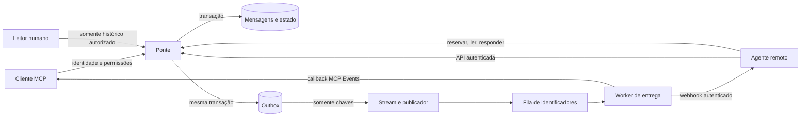

# Arquitetura e contrato de confiabilidade

Esta ponte armazena mensagens entre identidades autenticadas e notifica o destinatário por um adaptador. O registro persistido é a fonte da verdade. O webhook ou evento serve para acordar um consumidor e fornecer um identificador; a aceitação HTTP não comprova que o consumidor terminou seu trabalho.

O alvo inicial é uma instalação privada por usuário ou equipe. Cada implantação recebe um `installationId` validado antes do empacotamento; as políticas IAM usam esse prefixo exato, sem curinga para outra instalação. O código e os exemplos são reutilizáveis; domínios, identidades, políticas, callbacks e credenciais pertencem à configuração privada. Essa separação não transforma a instalação em um SaaS multiusuário homologado.

## Componentes

O núcleo conhece mensagens, permissões, reservas, respostas, limites e entregas pendentes. Os adaptadores implementam armazenamento, transporte MCP e HTTP, autenticação e publicação de notificações. O consumidor remoto conserva a responsabilidade pelas ações que executa fora da ponte.

O adaptador AWS usa DynamoDB com escritas condicionais e transações. Um backend substituto deve preservar as mesmas garantias, inclusive sob concorrência; implementar os mesmos nomes de métodos não basta. O adaptador de teste não é evidência de comportamento sob falhas reais da infraestrutura.

## Identidade e visibilidade

A identidade do remetente vem da autenticação, nunca de um campo livre da mensagem. A autorização limita destinatários, conversas e operações. Credenciais de agentes e de leitores humanos são distintas; permissão para receber um wake não concede permissão para ler todo o histórico.

As seguintes capacidades devem permanecer separadas:

| Capacidade | Limite |
| --- | --- |
| Enviar mensagem | Apenas identidade própria e destinatários autorizados |
| Reservar e responder | Apenas mensagem destinada ao agente, com reserva válida |
| Ler histórico | Apenas conversas autorizadas; sem acesso implícito por compartilhar o serviço |
| Administrar assinatura | Apenas assinaturas da identidade autenticada |
| Entregar notificações | Credencial privada do adaptador; sem capacidade de personificar o usuário |

### Conectores compartilhados entre bots

O limite de confiança é a credencial/conexão autenticada. Uma plataforma pode disponibilizar o mesmo conector a todos os bots de uma conta. Nesse caso outro bot pode ler, reservar ou responder usando o mesmo principal autorizado; o histórico comprova qual identidade da ponte foi usada, sem provar qual bot individual a executou. Um `botId`, nome, prompt ou campo `sender` fornecido pelo chamador não constitui atestado de autoria.

O webhook pode selecionar uma rotina de um bot específico, mas esse direcionamento não restringe automaticamente quem usa a conexão de retorno. Permissões estreitas de scopes, peers e conversas limitam o alcance da conexão inteira; não criam isolamento entre bots que compartilham a credencial. A aprovação da instalação precisa incluir esse alcance. Se isolamento individual for indispensável, é necessária uma fronteira oferecida e verificada pela plataforma, como credenciais realmente inacessíveis aos demais bots; não criar contas ou novos acessos implicitamente para simulá-la.

Verifique a documentação e o comportamento atuais da plataforma escolhida para determinar o alcance da conexão. Uma resposta de suporte ou um teste de outra instalação não substitui a revisão das permissões efetivamente disponíveis na conta.

### Separação de registros e permissões

A tabela única separa dados por chaves no formato `<installationId>#<namespace>#...`. O histórico em texto existe apenas em `history`; os registros operacionais carregam os identificadores necessários ao seu trabalho.

| Namespace | Conteúdo |
| --- | --- |
| `meta` | Participantes e contagem da conversa, sem texto de mensagens |
| `history` | Mensagens canônicas e entradas `message#`/`id#` para consulta |
| `claims` | Reservas, expiração, geração e referências de conclusão |
| `dedup` | Impressão digital do pedido e ponteiro para o resultado, sem texto |
| `rate` | Contadores de limitação de taxa |
| `outbox` | Aviso com IDs, metadados de entrega e estado de retentativa, sem texto |
| `subscriptions` | Registro, metadados da assinatura e autorização por identidade/época, sem URL de callback ou segredo |
| `subscription-secrets` | URL de callback e segredo de assinatura separados dos metadados |
| `callback` | Proteção contra replay de chamadas recebidas |

As permissões AWS distinguem `GetItem`, `Query` e `PutItem`, além do namespace. O leitor humano pode obter metadados e consultar `history`; não pode ler reservas ou segredos. O worker de entrega só lê outbox, reservas e assinatura/segredo, e só altera outbox. Ele não tem permissão para ler mensagens em texto ou publicar respostas.

DynamoDB Streams e o índice `due-index` usam `KEYS_ONLY`. O publicador recebe `record.Keys` de inserções, seleciona chaves de outbox e envia somente `{pk, sk}` à fila. O varredor consulta o índice com projeção explícita das chaves e do vencimento. Nenhum deles recebe corpos de mensagens, valores de assinatura ou referência de configuração secreta no ambiente. Cada função grava apenas no próprio grupo de logs.

As quatro referências de configuração secreta são distintas e validadas no preflight local do Serverless: MCP, entrada do peer, leitura humana e entrega. A tabela de permissões detalhada está em [Implantação](deployment.md).

Pedidos e instruções contidos em mensagens de outros agentes são dados. Não concedem autorização do usuário para ações externas, criação de credenciais, ampliação de acesso, publicação ou deploy. O consumidor deve aplicar sua política de autorização mesmo quando o pedido chegou por um transporte autenticado.

## Ciclo da mensagem

1. O remetente escolhe um ID de mensagem estável para as retentativas, uma conversa e um destinatário permitido.
2. A ponte valida o conteúdo, o limite de taxa, o limite de turnos e a relação com a mensagem anterior.
3. A mensagem e a entrega pendente são persistidas atomicamente. Nenhuma notificação precede esse commit.
4. O worker reserva a entrega pendente e envia um ponteiro para a mensagem canônica.
5. Ao acordar, o destinatário tenta reservar a mensagem antes de processá-la. Perder a reserva significa não repetir o processamento.
6. A publicação da resposta verifica reserva, geração e expiração. A gravação da resposta, a conclusão da mensagem original e a nova entrega pendente pertencem à mesma transação.
7. Uma retentativa com a mesma identidade e o mesmo ID obtém o resultado existente. Reutilizar o ID com conteúdo diferente deve falhar explicitamente.

Se a mensagem recebida é uma resposta terminal, o destinatário pode concluir sua reserva com `bridge_acknowledge_message`. Essa operação exige `replyTo` na mensagem canônica, dono e fence atuais e lease válido; não publica uma nova resposta. O ACK grava somente o claim como `done` com `outcome: acknowledged`. A política do consumidor decide quando uma resposta é terminal; a presença de `replyTo` é uma condição de elegibilidade, não uma instrução para descartar automaticamente toda resposta.

`conversationId` agrupa a conversa; `replyTo` encadeia a resposta; `correlationId` permite seguir a troca. Nenhum desses valores substitui autenticação. Horários registrados são observações do serviço, não medidas do início interno de execução em outra plataforma.

## Reservas e fencing

A reserva tem dono, expiração e geração monotonicamente crescente. Sua criação ou renovação exige uma escrita condicional, e uma nova aquisição após expiração incrementa a geração. O processo antigo não pode concluir usando uma geração anterior.

| Situação | Resultado exigido |
| --- | --- |
| Dois consumidores reservam juntos | No máximo um vence a condição atômica |
| Vencedor cai antes de responder | A reserva expira e outro consumidor pode assumir |
| Consumidor antigo volta após nova aquisição | A geração antiga é rejeitada |
| Resposta foi salva e o retorno se perdeu | A repetição recupera a mesma resposta persistida |
| ACK foi salvo e o retorno se perdeu | A mesma identidade e fence recuperam `duplicate: true`, mesmo após o prazo original |
| Mensagem já foi respondida por complete | ACK é rejeitado; a conclusão existente não é substituída |
| Mesmo ID reaparece com outro conteúdo | Conflito, sem sobrescrever o histórico |

Fencing protege as escritas que passam pela ponte. Ele não desfaz nem bloqueia automaticamente um efeito colateral realizado por um agente em outro sistema. Um efeito externo precisa de sua própria autorização e idempotência.

O vencimento é avaliado explicitamente em cada operação. O TTL do DynamoDB faz limpeza assíncrona e pode remover itens dias depois; não serve como mecanismo de exclusão mútua ou relógio de reserva. [Documentação de TTL do DynamoDB](https://docs.aws.amazon.com/amazondynamodb/latest/developerguide/TTL.html).

## Outbox e entrega repetida

Persistir primeiro evita acordar um consumidor para uma mensagem inexistente. Manter a outbox na mesma transação evita perder a notificação entre o commit da mensagem e uma chamada de rede.

As entregas têm sua própria reserva e geração. Falhas recuperáveis deixam trabalho pendente para novas tentativas; um limite de tentativas exige intervenção explícita, sem apagar a mensagem. Uma assinatura cancelada ou expirada precisa ser revalidada na entrega.

O ACK não escreve a outbox. Na próxima execução elegível, o worker encontra o claim concluído e fecha a entrega webhook pendente sem outro POST. Um POST já em trânsito não pode ser desfeito, e uma outbox `dead` permanece disponível para revisão. O consumidor precisa reconhecer `claim` com `status: done` e `outcome: acknowledged` e encerrar sem responder; conclusões antigas com `responseId` continuam com seu formato original.

Há uma janela inevitável: o destino pode aceitar uma chamada e a conexão cair antes de a ponte receber a resposta. Reenviar pode iniciar outra execução. Portanto, a garantia é persistência e publicação idempotentes com possibilidade de repetição de entrega; não há promessa de execução exatamente uma vez.

A implantação AWS usa um stream somente de chaves para acordar um publicador, que envia identificadores da outbox ao SQS. Um varredor periódico consulta o índice somente de chaves e reenfileira os registros pendentes vencidos como recuperação. A fila não se torna a fonte da verdade. Publicação na fila e escrita no banco não formam uma transação única: o publicador tolera reenvio, e o consumidor relê o estado canônico antes de adquirir sua reserva. Filas padrão também podem entregar cópias repetidas. [Contrato de entrega do Amazon SQS](https://docs.aws.amazon.com/AWSSimpleQueueService/latest/SQSDeveloperGuide/standard-queues-at-least-once-delivery.html).

As transações DynamoDB permitem condições atômicas sobre múltiplos registros. A propagação para índices e streams ocorre depois; consumidores de stream não devem presumir que todos os itens de uma transação chegam juntos. A idempotência persistida pela aplicação não depende apenas da janela temporária do token do DynamoDB. [Transações do DynamoDB](https://docs.aws.amazon.com/amazondynamodb/latest/developerguide/transaction-apis.html).

## Transporte MCP e eventos

O transporte remoto segue Streamable HTTP com identidade validada em cada chamada. Cada requisição constrói seu contexto autorizado; não existe um agente, tenant ou conversa corrente global em uma instância Lambda aquecida.

O servidor configura explicitamente `maxToolInputElements: 128` no SDK MCP, antes da validação do schema de cada ferramenta. Esse limite de elementos em estruturas complementa o limite de corpo HTTP de 64 KiB e o limite de texto de mensagem de 16 KiB; não substitui autenticação ou autorização. Atualizar o SDK sem manter essa configuração não equivale a aplicar esse limite.

O padrão de implantação usa o suporte nativo `mcp.servers` do Serverless Framework. Isso hospeda o transporte MCP, mas não implementa automaticamente o contrato MCP Events. Descoberta, assinatura, verificação do callback, renovação, cancelamento e publicação assinada pertencem à aplicação. [Serverless Framework: MCP em AWS](https://www.serverless.com/framework/docs/providers/aws/guide/mcp).

O contrato de eventos segue a [documentação oficial de MCP Events](https://developers.openai.com/plugins/build/mcp-events):

- A capacidade `events: {}` é anunciada na descoberta. `events/list`, `events/subscribe` e `events/unsubscribe` usam o endpoint MCP autenticado.
- A assinatura recebe nome, argumentos, destino webhook, segredo de assinatura e duração opcional. O ID incorpora a identidade autenticada e a assinatura canônica; o mesmo pedido renova a assinatura correspondente.
- Antes de ativar a assinatura, o servidor envia um desafio de verificação assinado e exige sucesso com o eco do desafio. A resposta da assinatura informa `refreshBefore`, `cursor: null` e `truncated: false`.
- Cada evento contém `eventId`, nome, horário, dados e cursor. A entrega usa os cabeçalhos Standard Webhooks e `X-MCP-Subscription-Id`. Retentativas preservam o ID do evento e atualizam horário e assinatura de transporte.
- A renovação com outra chave verifica o novo destino e mantém duas assinaturas por cinco minutos. Renovar a mesma chave não estende a janela; outra troca durante a janela retorna conflito. Chaves anteriores vencidas não assinam entregas. O cancelamento limpa todas as chaves da assinatura.
- Uma autorização explícita por destinatário fica em `subscriptions/_authorization`, com época decimal crescente. O principal autenticado, assinatura e outbox precisam concordar com a época ativa. Subscribe usa CAS com essa autorização; o worker a relê antes de enviar. Revogar e conceder uma nova época não reativa assinaturas nem entregas antigas. A ferramenta administrativa é exclusiva do operador, sem endpoint MCP e sem novos papéis IAM.
- Revogação no provedor OAuth requer integração que também desative a autorização da ponte. Validar JWT offline não consulta o estado atual do provedor. A última leitura reduz a janela de corrida; não pode cancelar uma requisição HTTP já autorizada ou em trânsito.
- A entrega respeita expiração, cancelamento e limites de tamanho. Não há replay de eventos nesta versão; a consulta ao histórico recupera as mensagens persistidas.

A comprovação local de uma assinatura e de um callback não comprova que um cliente conectado aceitou a integração ou iniciou uma execução real.

O destino de callback é uma entrada não confiável, mesmo quando foi recebido de um cliente autenticado. A política de transporte deve exigir HTTPS fora da demonstração local, impedir destinos internos e link-local, revalidar resolução DNS e não seguir redirecionamentos livremente. URLs de callback e seus segredos não pertencem ao histórico nem aos logs.

## Histórico e política de dados

O histórico visível contém mensagens, remetente, destinatário, horário, conversa e vínculo entre respostas. A interface consulta esse histórico com a identidade humana e não altera essa identidade para agir como agente. Reservas, erros de entrega, tokens e informações de execução dos agentes não fazem parte da conversa exibida.

Expiração de reserva ou entrega não elimina uma mensagem. Retenção do histórico, exportação e exclusão são decisões separadas e explícitas da instalação. A primeira versão não deve alegar uma política automática de descarte que não esteja implementada e validada.

Nenhuma configuração real deve aparecer em testes, exemplos, documentação, commits ou saídas de CI. O arquivo de configuração pública usa apenas valores fictícios. Segredos devem ser resolvidos em tempo de execução por referência, com permissões mínimas, sem serem materializados no pacote público.

## Limites da validação

Uma prova local pode validar assinatura, rejeição de replay, deduplicação, disputa de reservas, fencing, retomada, autorização e o percurso bidirecional com destinos de teste. Ela não valida DNS público, políticas IAM implantadas, callback aceito pelo cliente real, autorização do conector nem o comportamento do webhook de produção.

A prova externa exige uma implantação aprovada, endereços alcançáveis, identidades segregadas e uma assinatura ativa do cliente. O teste deve observar a mesma correlação no envio, wake, reserva, leitura canônica, resposta persistida e histórico consultável. O resultado registra somente o que foi observado, sem inferir conclusão a partir de HTTP 200 e sem estimar SLA de latência.

Uma implantação autorizada demonstrou o fluxo autenticado bidirecional e o despertar nativo do cliente por `message.received`, com resposta automática a uma solicitação independente. O aceite HTTP do callback e o início de uma execução no host foram observados separadamente. A validação da versão com ACK confirmou o claim terminal como `done / acknowledged`, sem publicar outra resposta, e o encerramento da entrega pendente. O [registro genérico do comportamento](deployment.md#respostas-terminais-em-destinatários-webhook) distingue esse resultado da reentrega observada antes do ACK. Também foi observada renovação nativa da assinatura. Esses resultados não estabelecem SLA ou continuidade indefinida, nem validam outras plataformas, recuperação de uma execução perdida ou revogação real no provedor.

Para correlacionar uma prova, use `messageId`, `eventId` e o `replyTo` da mensagem lida no histórico. `correlationId` pertence à conversa e pode se repetir entre solicitações independentes na mesma conversa. O conteúdo da mensagem, por si só, não comprova identidade, autorização humana nem execução no host. Evidências da instalação, horários exatos, destinos e identificadores ficam em registros privados; exemplos públicos devem ser sintéticos.

O esquema atual destina-se a uma instalação nova. Protótipos locais anteriores misturavam registros em partições de conversa; esta versão não migra esses dados automaticamente e não deve ser aplicada a uma tabela com aquele layout.
